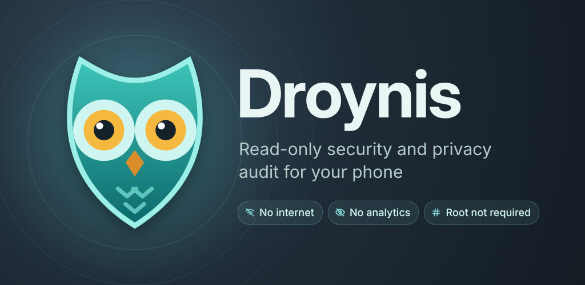

## Alexandros - capitan0n

Electrical & Computer Engineering student at the University of Peloponnese, specializing in Computer Science. I build defensive security and privacy tools for Linux and Android, with a focus on system hardening, blue team work and digital forensics.

---
### [Droynis](https://github.com/capitan0n/droynis)

  

A read-only security and privacy audit for Android, inspired by Lynis. Droynis checks the phone it runs on, explains every finding with the raw evidence, and opens the Settings screen that fixes it. It never changes anything itself.

[Visit the Droynis website](https://capitan0n.github.io/droynis/)

- **100+ hardening checks**: device integrity, access control, apps and permissions, suspicious apps, network and radios. [Full catalog](https://github.com/capitan0n/droynis/blob/main/docs/CHECKS.md).
- **Four privilege tiers**: Base (public APIs), ADB, Shizuku and opt-in Root. Privileged tiers run only a fixed list of read-only commands.
- **Offline by design**: no `INTERNET` permission, no Google Play Services, no analytics.
- **Honest results**: a check passes only on a value it actually read. When Android won't say, it's Unknown, never Passed.
- **Verifiable supply chain**: reproducible builds, signed releases with SHA-256 checksums and GitHub build attestations.
- **Scheduled scans** that report what got worse or got fixed, and diff-able Markdown/JSON reports with personal details redacted.

Kotlin · Android · [Design notes](https://github.com/capitan0n/droynis/blob/main/docs/DESIGN.md)

---

### Other projects

- **[dnser](https://github.com/capitan0n/dnser)** - Zero-dependency Python CLI, published on PyPI, that switches Linux DNS through NetworkManager or systemd-resolved, with DNS-over-TLS, leak-safe fallback, benchmarking and one-command rollback. Security-hardened root operations and automated CI/CD releases with OIDC trusted publishing.

- **[sshd-lint](https://github.com/capitan0n/sshd-lint)** - Static analyzer for `sshd_config`. Encodes OpenSSH hardening best practices into repeatable, automated checks so misconfigurations get caught before they ship. Published on PyPI.

- **[probolos](https://github.com/capitan0n/probolos)** *(beta)* - Deny-by-default USB gate for Linux: new devices stay blocked until you approve them, after identity, behaviour and storage checks. Defends against BadUSB and rogue keyboards. Published on PyPI.

- **Digital forensics tooling** *(private, in progress)* - to be published.

### Stack

Kotlin · Android · Python · Bash · Linux

### Interests

Homelab & self-hosting · network security · privacy/anonymity tooling · FOSS ecosystems

### Contact

Open to internships and entry-level roles in security engineering, SOC analysis, incident response/DFIR, DevSecOps and Linux systems administration.

- 🎓 Diploma, expected 2027
- 📧 capitan0n@protonmail.com
- 📍 Greece

<!-- Go deep in a narrow field until it reveals a gap. -->
